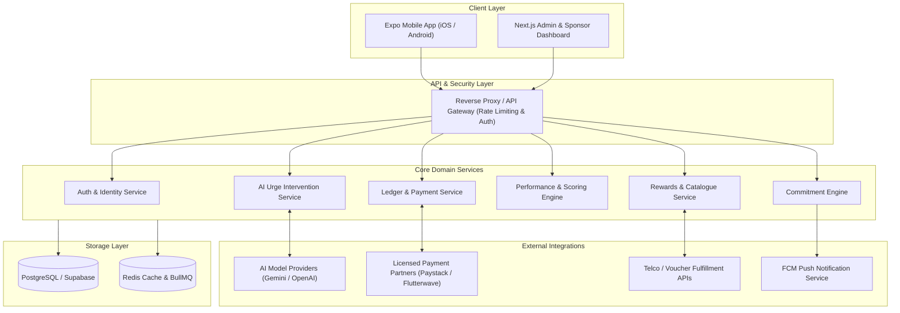

# Startup Concept & Market Opportunity Report
## Financial Accountability + AI-Powered Habit Change + Performance-Based Rewards
### *A Platform That Rewards People for Taking Back Control of Their Habits*

---

| **Metadata** | **Details** |
| :--- | :--- |
| **Proposed Category** | Behavioural Wellness & Recovery Technology |
| **Initial Market Focus** | Nigeria and West Africa (with Pan-African & International expansion potential) |
| **Business Concept** | Mobile platform combining financial commitment, AI-assisted urge management, measurable progress, and performance-based rewards |
| **Target Tagline** | *Better habits. Real rewards.* |

---

## Table of Contents
1. [Executive Summary](#1-executive-summary)
2. [The Rewards Model: How It Works](#2-the-rewards-model-how-it-works)
   - [2.1 Earning Mechanisms & Scoring](#21-earning-mechanisms--scoring)
   - [2.2 Real-World Application Scenarios](#22-real-world-application-scenarios)
3. [Multi-Source Reward Ecosystem](#3-multi-source-reward-ecosystem)
   - [3.1 Reward Distribution Models](#31-reward-distribution-models)
4. [Evidence Base & Behavioral Science](#4-evidence-base--behavioral-science)
5. [Market Opportunity & Competitive Landscape](#5-market-opportunity--competitive-landscape)
   - [5.1 Why Nigeria is a Credible Starting Market](#51-why-nigeria-is-a-credible-starting-market)
   - [5.2 Target Customer Segments](#52-target-customer-segments)
   - [5.3 Competitive Positioning Matrix](#53-competitive-positioning-matrix)
6. [Product Positioning & Brand Strategy](#6-product-positioning--brand-strategy)
   - [6.1 User Experience & Emotional Principles](#61-user-experience--emotional-principles)
7. [Full Feature Architecture (8 Modules)](#7-full-feature-architecture-8-modules)
8. [Rewards Unit Economics & Fraud Prevention](#8-rewards-unit-economics--fraud-prevention)
   - [8.1 Sponsored Challenge Economics](#81-sponsored-challenge-economics)
   - [8.2 Hybrid Financial Structure](#82-hybrid-financial-structure)
   - [8.3 Anti-Abuse & Gaming Protections](#83-anti-abuse--gaming-protections)
9. [Revenue Model & Monetisation](#9-revenue-model--monetisation)
10. [Technology Stack & System Architecture](#10-technology-stack--system-architecture)
    - [10.1 System Architecture Diagram](#101-system-architecture-diagram)
    - [10.2 Security, Privacy & Compliance](#102-security-privacy--compliance)
    - [10.3 Regulatory & Financial Compliance (CBN)](#103-regulatory--financial-compliance-cbn)
11. [MVP Phased Implementation Roadmap](#11-mvp-phased-implementation-roadmap)
12. [Metrics & Success Measurement (KPIs)](#12-metrics--success-measurement-kpis)
13. [Risk Matrix & Mitigation Strategies](#13-risk-matrix--mitigation-strategies)
14. [Initial Launch Focus](#14-initial-launch-focus)
15. [Go-to-Market Strategy](#15-go-to-market-strategy)
16. [Final Strategic Assessment](#16-final-strategic-assessment)
17. [Academic References & Data Sources](#17-academic-references--data-sources)
18. [Critical Founder Decisions Prior to Build](#18-critical-founder-decisions-prior-to-build)

---

## 1. Executive Summary

Introducing **performance-based rewards** transforms traditional commitment devices from punitive risk mechanisms into positive behavioral reinforcement systems.

Rather than building an app where users deposit capital and risk losing it upon relapse, this platform allows users to make structured commitments, demonstrate verifiable progress, and **earn tangible rewards for positive behavioral change**.

```
TRADITIONAL COMMITMENT APP:
"If I fail, I lose my money." (Fear / Negative Loss Aversion)
                     ▼
PROPOSED REWARD PLATFORM:
"Every positive step brings me closer to a reward." (Hope / Positive Reinforcement)
```

This fundamental psychological shift dramatically improves long-term retention: users maintain reasons to return even after initial novelty or motivation wanes.

### The Five Core Pillars

```
┌────────────────────────────────────────────────────────────────────────┐
│                        THE FIVE PLATFORM PILLARS                       │
├──────────────────┬─────────────────────────────────────────────────────┤
│ 1. COMMITMENT    │ Users identify a target behaviour and establish a   │
│                  │ structured, time-bounded personal goal.             │
├──────────────────┼─────────────────────────────────────────────────────┤
│ 2. ACCOUNTABILITY│ Users choose between optional financial stakes or   │
│                  │ social/non-financial commitment pathways.           │
├──────────────────┼─────────────────────────────────────────────────────┤
│ 3. INTERVENTION  │ On-demand AI assistants and behavioural tools help  │
│                  │ navigate cravings, urges, and high-risk triggers.   │
├──────────────────┼─────────────────────────────────────────────────────┤
│ 4. PERFORMANCE   │ Evaluates holistic recovery activity engagement     │
│                  │ rather than relying solely on fragile streaks.      │
├──────────────────┼─────────────────────────────────────────────────────┤
│ 5. REWARDS       │ Performance unlocks points, partner vouchers, data  │
│                  │ bundles, sponsor perks, and cash incentives.        │
└──────────────────┴─────────────────────────────────────────────────────┘
```

> **Central Proposition:**  
> *"We don't just help people stop bad habits. We reward them for building better ones."*

---

## 2. The Rewards Model: How It Works

The platform differentiates itself through the **Progress-to-Rewards Engine**. Users earn points for completing substantive, scientifically backed recovery tasks rather than simply opening the app.

### Illustrative User Dashboard

```
┌────────────────────────────────────────────────────────────────────────┐
│ ACTIVE CHALLENGE: 30-Day Sports Betting Free                           │
│ Status: Day 21 of 30                                                   │
├────────────────────────────────────────────────────────────────────────┤
│ PROGRESS POINTS:  680 / 1,000 Pts  [██████████████░░░░] 68%            │
├────────────────────────────────────────────────────────────────────────┤
│ PERFORMANCE SNAPSHOT:                                                  │
│   • 18 Successful Daily Check-ins                                      │
│   • 5 Real-Time Urges Managed with AI Assistant                        │
│   • 3 Weekly Milestone Reflections Completed                           │
├────────────────────────────────────────────────────────────────────────┤
│ REWARD BALANCE EARNED:                                                 │
│   ₦2,500 Voucher Value (Eligible for Telco Data / Merchant Redemption) │
└────────────────────────────────────────────────────────────────────────┘
```

---

### 2.1 Earning Mechanisms & Scoring

| Performance Activity | Illustrative Points | Validation Method |
| :--- | :---: | :--- |
| **Complete daily recovery check-in** | 10 | Daily prompt response + reflection entry |
| **Complete guided urge-management exercise** | 15 | Active participation in 3–5 min AI coping workflow |
| **Complete weekly behavioral reflection** | 20 | Structured review of weekly triggers & patterns |
| **Attain 7-day milestone** | 50 | 7 consecutive days of active check-in logging |
| **Attend scheduled support session / webinar** | 30 | Partner verified attendance or check-in code |
| **Complete full 30-day challenge** | 150 | Challenge completion verification criteria |
| **Maintain active recovery plan** | 25 | Updating triggers, coping strategies, and contacts |

> [!IMPORTANT]
> **Anti-Gaming Design Rule:** Users should **not** receive reward points merely for clicking "I resisted an urge," as this directly incentivizes false reporting. Points are awarded exclusively for **verified engagement with recovery-support activities** (e.g., completing a 5-minute breathing session, logging a detailed trigger analysis, or attending a counseling group), while outcome metrics are tracked independently.

---

### 2.2 Real-World Application Scenarios

The framework adapts across diverse behavioral challenges:

#### Scenario A: Sports Betting & Gambling Cessation
* **User Commitment:** 30 days without sports betting.
* **Measurable Activities:** Daily check-ins, configuring gambling-specific financial transaction limits, engaging the AI urge companion during live matches, and completing weekly spending reflections.
* **Potential Rewards:** ₦1,000 mobile data voucher, ₦2,000 retail shopping voucher, free access to financial planning modules, and sponsored completion bonuses.
* **Verification Note:** No intrusive banking scrape required; progress is evaluated through active intervention compliance, self-reporting safeguards, and optional accountability partner verification.

#### Scenario B: Excessive Social Media & Screen Time Reduction
* **User Commitment:** Reduce recreational social media usage from 5 hours to 2 hours daily.
* **Measurable Activities:** OS-level screen time permissions (iOS Screen Time / Android Digital Wellbeing API), scheduled app-blocking sessions, and completing offline productive tasks.
* **Potential Rewards:** High-speed data bundles, streaming entertainment discounts, audio book credits, and premium app features.
* **Verification Note:** Highly objective measurement; ideal candidate for early MVP validation.

#### Scenario C: Smoking & Nicotine Cessation
* **User Commitment:** Structured clinical smoking reduction/cessation plan.
* **Measurable Activities:** Daily craving logs, tracking nicotine replacement therapy (NRT) adherence, mindfulness breathing exercises, and counseling attendance.
* **Potential Rewards:** Pharmacy vouchers, health and wellness perks, fresh grocery discounts, and sponsored clinical check-ups.
* **Safety Mandate:** Never encourage dangerous unmonitored withdrawal for substances where medical detoxification is clinically indicated.

#### Scenario D: Pornography & Compulsive Sexual Behavior
* **User Commitment:** 30-day structured behavioral recovery plan.
* **Measurable Activities:** Trigger boundary setup, nighttime device-lock compliance, daily journaling, and support group participation.
* **Potential Rewards:** Educational course subscriptions, fitness memberships, digital wellness badges, and entertainment passes.
* **Privacy Mandate:** Zero intrusive device logging, no upload of personal browsing histories, and complete pseudo-anonymous user identity.

#### Scenario E: Academic Procrastination & Excessive Gaming (Students)
* **User Commitment:** 2 hours of focused daily study with recreational gaming limits.
* **Measurable Activities:** Pomodoro study session tracking, syllabus milestone check-offs, and study group check-ins.
* **Potential Rewards:** Campus bookstore vouchers, tech discounts, internet data subscriptions, and certification course fee waivers.

#### Scenario F: Compulsive Spending & Retail Therapy
* **User Commitment:** 30-day non-essential spending freeze.
* **Measurable Activities:** Voluntary discretionary spending logging, 48-hour purchase delay rule utilization, and weekly financial literacy study.
* **Potential Rewards:** Matching savings bonuses, budgeting software licenses, and supermarket gift cards.

---

## 3. Multi-Source Reward Ecosystem

A common vulnerability of reward platforms is funding all incentives from the startup's balance sheet. As active users scale, reward liabilities quickly become unsustainable. 

The platform resolves this by establishing a **Multi-Sided B2B2C Reward Marketplace**:

```
           ┌──────────────────────────────────────────────┐
           │        MULTI-SIDED REWARD MARKETPLACE        │
           └──────────────────────┬───────────────────────┘
                                  │
    ┌─────────────────┬───────────┴───────────┬─────────────────┐
    │                 │                       │                 │
    ▼                 ▼                       ▼                 ▼
┌──────────────┐ ┌──────────────┐      ┌──────────────┐  ┌──────────────┐
│  ENTERPRISE  │ │  TELECOMS &  │      │ UNIVERSITIES │  │  MERCHANTS & │
│  EMPLOYERS   │ │   FINTECHS   │      │  & COLLEGES  │  │   BRANDS     │
│ Sponsoring   │ │ Sponsoring   │      │ Sponsoring   │  │ Providing    │
│ staff health │ │ customer data│      │ student habit│  │ product disc-│
│ & focus      │ │ & wellness   │      │ & study plans│  │ ounts & perks│
└──────────────┘ └──────────────┘      └──────────────┘  └──────────────┘
```

| Reward Source | Operating Mechanism | Commercial Driver |
| :--- | :--- | :--- |
| **Startup-Funded Rewards** | Capped introductory welcome bonuses | Customer acquisition & initial activation |
| **Brand-Sponsored Challenges** | FMCG/Retailers fund branded 30-day wellness challenges | Targeted positive CSR & user brand acquisition |
| **Employer Corporate Wellness** | Companies sponsor workforce habit challenges | Reduced absenteeism & increased productivity |
| **University Partnerships** | Tertiary institutions sponsor student wellness programmes | Student academic performance & mental well-being |
| **Healthcare & Insurance Partners** | HMOs co-fund preventative habit improvement | Reduced actuarial claim costs & hospitalization risk |
| **Non-Financial Digital Rewards** | Premium features, streak shields, and peer recognition | Zero marginal fulfillment cost |

### Real-World B2B2C Examples
* **Telco Digital Wellness Partnership:** A major telecommunications provider (e.g., MTN or Airtel) sponsors a 30-day "Digital Health & Focus" challenge. Participants who successfully hit their screen-time targets receive sponsored data bundles directly fulfilled via Telco API. The telco gains authentic brand goodwill and data usage, while the platform eliminates reward acquisition costs.
* **University Student Wellness Grant:** A university student affairs department funds educational vouchers for 500 undergraduates who complete a 30-day study consistency and anti-betting program.

---

### 3.1 Reward Distribution Models

```
RECOMMENDED STARTING FRAMEWORK:
1. Guaranteed Milestone Rewards (Predetermined, transparent vouchers upon task completion)
2. Reward Points & Dynamic Redemption (Flexible catalogue of airtime, data, and vouchers)
3. Sponsored Group Cohorts (Fixed sponsor budget distributed among qualifying finishers)
```

> [!CAUTION]
> **Anti-Gambling Warning:** Avoid lottery-style random prize draws, variable-ratio loot boxes, or speculative sweepstakes. Introducing randomized reward mechanics to individuals attempting to recover from compulsive gambling or addictive habits is counter-productive and ethically indefensible. Rewards must be **transparent, earned, and deterministic**.

---

## 4. Evidence Base & Behavioral Science

Contingency Management (CM) and incentive-based behavioral interventions are grounded in decades of rigorous peer-reviewed clinical research:

### 1. Financial Incentives & Substance Abstinence (2025 Meta-Analysis)
* **Citation:** *Nicotine & Tobacco Research* (2025). Systematic review and meta-analysis of 39 randomized controlled trials ($N = 27,845$).
* **Finding:** Financial incentives significantly increased verified abstinence across substance use disorders with an **odds ratio of 1.93** ($95\%\text{ CI: } 1.66–2.24$). Statistically significant positive effects persisted at 12-month post-intervention follow-ups.
* **Startup Implication:** Tangible incentives have a verified empirical basis for sustaining behavioral cessation.

### 2. Incentives for Health Behaviour Change (Annual Review of Public Health, 2026)
* **Citation:** Glanz, K., Thirumurthy, H. & D'Cruz, N. (2026). Comprehensive analysis of 39 systematic reviews.
* **Finding:** Incentives deliver superior behavioral modification when they are:
  1. Delivered immediately following the target behavior (low delay-discounting).
  2. Personally meaningful in value.
  3. Paired with objective outcome verification.
* **Startup Implication:** The application must reward frequent micro-milestones rather than delaying recognition to day 90.

### 3. Incentives for Mental Health & Therapy Adherence
* **Citation:** Meta-analysis on Contingency Management in outpatient mental health settings (*PubMed Central*).
* **Finding:** Financial incentives demonstrate maximum efficacy in driving **treatment engagement**, clinical appointment attendance, and homework compliance.
* **Startup Implication:** Rewards should directly reinforce participation in supportive recovery actions, not solely the final outcome.

### 4. Non-Financial Digital Contingency (Re-Connect Intervention, 2024)
* **Citation:** *Journal of Applied Behavior Analysis* (2024).
* **Finding:** Gating access to favored smartphone entertainment apps behind the completion of healthy offline micro-habits achieved comparable compliance to direct monetary payments.
* **Startup Implication:** Digital privileges and in-app utility provide strong incentive power with zero cash drain.

---

## 5. Market Opportunity & Competitive Landscape

### 5.1 Why Nigeria is a Credible Starting Market

1. **Acute Behavioral Urgency (Undergraduate Sports Betting Prevalence):**  
   A 2025 epidemiological study on Nigerian university students revealed:
   * **36.7%** lifetime sports betting participation.
   * **47.2%** of active past-year bettors met diagnostic criteria for problem gambling.
   * **64.2%** of active bettors reported measurable negative academic and financial consequences.  
   *(Source: Discover Social Science and Health / PMC12397461)*.
2. **Modern Digital Payment Infrastructure:**  
   According to the Central Bank of Nigeria's *Payment System Vision 2028*, electronic transactions exceeded **₦1.2 quadrillion** in 2025. Payment rails (NIP, Paystack, Flutterwave, Moniepoint) allow seamless instant micro-disbursements of data, airtime, and vouchers.
3. **Established Mobile-First Youth Demographic:**  
   Over 70% of Nigeria's population is under 30 years old, highly urbanized, digitally literate, and experiencing high exposure to sports betting marketing and social media overload.

---

### 5.2 Target Customer Segments

| Customer Segment | Core Behavioral Pain Points | Acquisition Channel | Launch Priority |
| :--- | :--- | :--- | :---: |
| **University Students (18–25)** | Sports betting, exam procrastination, gaming, social media | Campus ambassadors, student unions | **P0 (Immediate)** |
| **Young Professionals (22–35)** | Compulsive screen time, retail shopping, nicotine, stress habits | LinkedIn, corporate wellness pilots | **P0 (Immediate)** |
| **Corporate Workforces** | Burnout, low productivity, digital distractions | B2B HR benefits programs | **P1 (Growth)** |
| **Clinical Recovery Seekers** | Chronic behavioral dependence, problem gambling | Psychologist & therapy referrals | **P2 (Specialized)** |

---

### 5.3 Competitive Positioning Matrix

```
┌────────────────────────────────────────────────────────────────────────┐
│                      COMPETITIVE LANDSCAPE                             │
├────────────────────┬───────────┬───────────┬───────────┬───────────────┤
│ CAPABILITY         │ FORFEIT   │ BEEMINDER │ OPAL      │ PROPOSED      │
│                    │ (Loss)    │ (Loss)    │ (Blocker) │ PLATFORM      │
├────────────────────┼───────────┼───────────┼───────────┼───────────────┤
│ Financial Stakes   │ Yes (Loss)│ Yes (Loss)│ No        │ Optional      │
│ Positive Rewards   │ No        │ No        │ No        │ Core Engine   │
│ AI Urge Assistant  │ No        │ No        │ No        │ Core Engine   │
│ Recovery Workflows │ No        │ No        │ No        │ Core Engine   │
│ Screen-Time Sync   │ Manual    │ API/Manual│ Native OS │ Native + App  │
│ Multi-Sided B2B2C  │ No        │ No        │ No        │ Core Model    │
│ African Ecosystem  │ None      │ None      │ None      │ Native Focus  │
└────────────────────┴───────────┴───────────┴───────────────┴───────────┘
```

---

## 6. Product Positioning & Brand Strategy

```
AVOID:   "The App That Fines You When You Fail Addiction"
EMBRACE: "Take Control. Make Progress. Get Rewarded."
```

Position the product as an empowering **Behavioral Wellness & Focus Platform**, avoiding stigmatizing clinical labels that trigger shame or denial.

### Brand Personality
* **Encouraging, not Judgmental:** Every relapse is treated as clinical data to adjust coping plans, not moral failure.
* **Private & Secure:** Anonymous handles, zero public disclosure of personal behavioral targets.
* **Actionable & Pragmatic:** Delivers real-time cognitive tools the second an urge strikes.
* **Positive & Rewarding:** Celebrates micro-milestones and tangible daily consistency.

---

### 6.1 User Experience & Emotional Principles

* **Small Wins Over Streaks:** A single lapse on Day 28 should not wipe out 27 days of neurological healing. The app rewards cumulative positive days and habit reduction ratios.
* **The "No-Judgment Restart":** If a user reports a relapse, the app displays zero alarmist red screens or penalty animations. Instead, it prompts: *"What triggered this urge? Let's analyze what happened and adapt your safety plan."*
* **Emergency Urge SOS:** Floating quick-access button instantly opens grounding exercises, breathing pacers, or connects to a designated accountability peer.

---

## 7. Full Feature Architecture (8 Modules)

```
┌─────────────────────────────────────────────────────────────────────────┐
│                    APPLICATION MODULE ARCHITECTURE                      │
├───────────────────────────┬─────────────────────────────────────────────┤
│ 1. ONBOARDING & ASSESSMENT│ Habit intake, baseline audit, trigger check │
├───────────────────────────┼─────────────────────────────────────────────┤
│ 2. COMMITMENT ENGINE      │ 7/30/90-day targets, financial/free stakes  │
├───────────────────────────┼─────────────────────────────────────────────┤
│ 3. AI URGE INTERVENTION   │ Real-time conversational grounding & coping │
├───────────────────────────┼─────────────────────────────────────────────┤
│ 4. REWARDS ENGINE         │ Point accounting, voucher issuing, rules    │
├───────────────────────────┼─────────────────────────────────────────────┤
│ 5. WALLET & TRANSACTIONS  │ Deposit escrow, refund rules, disbursement  │
├───────────────────────────┼─────────────────────────────────────────────┤
│ 6. PEER ACCOUNTABILITY    │ Anonymous circles, verified mentor checks   │
├───────────────────────────┼─────────────────────────────────────────────┤
│ 7. BEHAVIORAL ANALYTICS   │ Craving patterns, savings calculation, maps │
├───────────────────────────┼─────────────────────────────────────────────┤
│ 8. ADMIN & SPONSOR PORTAL │ Campaign management, audit logs, analytics  │
└───────────────────────────┴─────────────────────────────────────────────┘
```

### Detailed Functional Breakdown

1. **User Onboarding & Behavioral Assessment:** Multi-factor authentication, self-assessment questionnaires, trigger cataloging, baseline habit frequency logging, and emergency contact assignment.
2. **Personal Commitment Engine:** Configurable time horizons (7, 14, 30, 90 days), custom frequency thresholds, and flexible financial stake selection.
3. **AI Urge Intervention Engine (Core Differentiator):**  
   Context-aware AI companion activated when cravings peak:
   * *In-the-moment cognitive reframing.*
   * *Guided 4-7-8 breathing and physiological sigh audio pacers.*
   * *Delayed decision barriers (15-minute urge surf timer).*
   * *Instant escalation to vetted human crisis helplines.*
4. **Performance & Rewards Engine:** Real-time points ledger, eligibility validation, tier advancement, and automated catalog redemptions (airtime, data, retail gift cards).
5. **Commitment Wallet & Financial Ledger:** Segregated user deposit escrow, automated performance refunds, transaction history, and payout integrations with regulated payment service providers.
6. **Accountability & Community Module:** 1-on-1 private accountability partnerships, anonymous group support circles, and milestone cheer features.
7. **Analytics & Progress Insights:** Trigger correlation heatmaps, estimated financial capital saved from curtailed habits, and longitudinal recovery progress.
8. **Admin & Enterprise Sponsor Dashboard:** Corporate challenge setup, real-time aggregate anonymous employee wellbeing metrics, and reward budget controls.

---

## 8. Rewards Unit Economics & Fraud Prevention

### 8.1 Sponsored Challenge Economics (Illustrative 100-Person Cohort)

```
Sponsor Budget Committed: ₦500,000
├── Platform Management & Tech Delivery Fee (40%):  ₦200,000 (Gross Margin)
└── Reward Disbursement Pool (60%):                 ₦300,000
    └── 60 Successful Finishers × ₦5,000 Voucher:   ₦300,000 (100% Funded)
```

The startup operates with **zero reward balance sheet liability**: incentives are pre-funded by corporate sponsors before cohort launch.

---

### 8.2 Hybrid Financial Structure

* **Tier 1 (Free Commitment):** Zero user capital required. Users participate in public/sponsored challenges, earn points, and redeem sponsor-funded perks.
* **Tier 2 (Self-Staked Commitment):** Users voluntarily deposit funds (e.g., ₦10,000) as commitment collateral held in escrow by a licensed payment partner. Achieving target performance unlocks 100% capital return plus earned reward bonuses.

---

### 8.3 Anti-Abuse & Gaming Protections

```
┌──────────────────────┐     ┌──────────────────────┐     ┌──────────────────────┐
│  DEVICE RISK SIGNALS │ ──▶ │  SERVER-SIDE CHECKS  │ ──▶ │ HUMAN AUDIT TRIGGER  │
│  • Hardware IMEI ID  │     │  • Impossible speeds │     │  • High-value claims │
│  • Geo-velocity test │     │  • Pattern anomalies │     │  • Random spot checks│
│  • Root/Jailbreak ban│     │  • Strict rate-limits│     │  • Account freeze    │
└──────────────────────┘     └──────────────────────┘     └──────────────────────┘
```

* **Rate-Limited Micro-Interventions:** Maximum points awarded per 24-hour cycle to neutralize bot farming.
* **Multi-Factor Behavioral Verification:** Daily check-ins require natural-language qualitative reflections analyzed for originality.
* **Proportionate Verification:** Low-value data vouchers require automated checks; high-value cash redemptions trigger secondary review.

---

## 9. Revenue Model & Monetisation

```
┌────────────────────────────────────────────────────────────────────────┐
│                        DIVERSIFIED REVENUE STREAMS                     │
├────────────────────┬─────────────────────────────┬─────────────────────┤
│ REVENUE STREAM     │ DESCRIPTION                 │ PRICING HYPOTHESIS  │
├────────────────────┼─────────────────────────────┼─────────────────────┤
│ Consumer Premium   │ Advanced AI analysis, streak│ ₦1,500 – ₦5,000 / mo│
│ SaaS (B2C)         │ shields, custom challenges  │ ($1.00 – $3.50 USD) │
├────────────────────┼─────────────────────────────┼─────────────────────┤
│ Sponsored Cohorts  │ Brands sponsor public       │ ₦500k – ₦5M per     │
│ (B2B Brand)        │ behavioral challenges       │ campaign            │
├────────────────────┼─────────────────────────────┼─────────────────────┤
│ Corporate Wellness │ Enterprise employee focus & │ ₦1,500 / seat / mo  │
│ (B2B Enterprise)   │ wellness subscription       │                     │
├────────────────────┼─────────────────────────────┼─────────────────────┤
│ Merchant Affiliate │ Commission on voucher       │ 3% – 8% transaction│
│ Marketplace        │ redemptions                 │ fee                 │
└────────────────────┴─────────────────────────────┴─────────────────────┘
```

### Indicative B2C Subscription Economics
At 10,000 Active Users with a 6% conversion rate to the Plus Tier (₦2,500/month):
$$\text{MRR} = 600 \text{ subscribers} \times ₦2,500 = ₦1,500,000 \text{ monthly}$$
This excludes corporate challenge licensing, affiliate merchant commissions, and institutional contracts.

---

## 10. Technology Stack & System Architecture

| Layer | Recommended Technology | Strategic Justification |
| :--- | :--- | :--- |
| **Mobile Client** | React Native (Expo) + TypeScript | Cross-platform iOS/Android from single codebase |
| **Backend API** | Node.js / NestJS | Enterprise-grade modular microservices |
| **Primary Database** | PostgreSQL (hosted on Supabase) | Relational integrity for financial ledgers |
| **Authentication** | Supabase Auth (JWT + MFA) | Secure role-based session governance |
| **AI Intelligence** | Gemini / OpenAI via LangChain wrapper | Multi-model provider redundancy & failover |
| **Async Tasks & Queues**| Redis + BullMQ | Real-time rate limiting & scheduled check-ins |
| **Push Notifications** | Expo Notifications / FCM | Timely contextual craving alerts |
| **Payment Integration**| Paystack / Flutterwave APIs | Regulated Nigerian payment orchestration |
| **Admin Web Portal** | Next.js 15 + Tailwind CSS | Responsive dashboard for sponsors and ops |

---

### 10.1 System Architecture Diagram



---

### 10.2 Security, Privacy & Compliance
* **Data Privacy Regulations:** Full compliance with the **Nigeria Data Protection Act (NDPA 2023)** and international standards. Behavioral and habit records are classified as sensitive personal data with strict purpose-limited consent.
* **Zero PII Exposure to AI:** Sensitive user identifiers are sanitized prior to prompt construction in compliance with strict privacy boundaries.
* **Cryptographic Ledger Integrity:** Financial balances and reward point logs utilize immutable audit tables with row-level hashing.

---

### 10.3 Regulatory & Financial Compliance (CBN)
Under Central Bank of Nigeria (CBN) regulations, non-bank fintechs cannot hold retail deposits without specific Mobile Money Operator (MMO) or payment banking licenses.

```
REGULATORY RULE:
The startup must NEVER hold customer deposits in a generic corporate bank account.
                 │
                 ▼
COMPLIANT SOLUTION:
1. MVP: Launch with 100% Sponsor-Funded Rewards (Zero user capital deposited).
2. Phase 2 Financial Stakes: Partner directly with a licensed MMO or Trustee
   to manage escrow wallets compliantly.
```

---

## 11. MVP Phased Implementation Roadmap

```
┌────────────────────────────────────────────────────────────────────────┐
│                        MVP EXECUTION PHASES                            │
├────────────────────┬───────────────────────────────────────────────────┤
│ PHASE 1            │ • 40 User & Clinical Interviews                   │
│ Research & Specs   │ • Finalize 2 core habit categories                │
│ (Weeks 1–3)        │ • Validate initial B2B sponsor willingness        │
├────────────────────┼───────────────────────────────────────────────────┤
│ PHASE 2            │ • Build Expo mobile app & Supabase backend        │
│ Core MVP Build     │ • Integrate AI urge intervention engine           │
│ (Weeks 4–10)       │ • Deploy Points-to-Rewards calculation engine     │
├────────────────────┼───────────────────────────────────────────────────┤
│ PHASE 3            │ • 50–100 person closed university pilot cohort    │
│ Controlled Pilot   │ • Deploy ₦250k sponsored reward pool              │
│ (Weeks 11–14)      │ • Measure 30-day retention & outcome metrics      │
├────────────────────┼───────────────────────────────────────────────────┤
│ PHASE 4            │ • Onboard first 3 paid commercial brand sponsors  │
│ Commercial Pilot   │ • Introduce accountability partner features       │
│ (Months 4–6)       │ • Expand to secondary cities in Nigeria           │
├────────────────────┼───────────────────────────────────────────────────┤
│ PHASE 5            │ • Evaluate licensed escrow for self-staked stakes │
│ Expansion          │ • Corporate HR B2B enterprise tier launch         │
│ (Months 7–12)      │ • West African regional pilot (Ghana/Kenya)       │
└────────────────────┴───────────────────────────────────────────────────┘
```

---

## 12. Metrics & Success Measurement (KPIs)

```
┌────────────────────────────────────────────────────────────────────────┐
│                     PLATFORM SUCCESS SCORECARD                         │
├───────────────────────┬────────────────────────────────────────────────┤
│ METRIC                │ TARGET BENCHMARK OBJECTIVE                     │
├───────────────────────┼────────────────────────────────────────────────┤
│ Onboarding Completion │ > 65% of downloads complete habit intake       │
├───────────────────────┼────────────────────────────────────────────────┤
│ Day-7 User Retention  │ > 40% active engagement                        │
├───────────────────────┼────────────────────────────────────────────────┤
│ Day-30 User Retention │ > 25% sustained challenge engagement           │
├───────────────────────┼────────────────────────────────────────────────┤
│ Urge Intervention Rate│ > 70% of logged cravings engage with coping AI │
├───────────────────────┼────────────────────────────────────────────────┤
│ Challenge Completion  │ > 45% of cohort achieve target milestones      │
├───────────────────────┼────────────────────────────────────────────────┤
│ Sponsor Renewal Rate  │ > 75% cohort budget re-commitment             │
├───────────────────────┼────────────────────────────────────────────────┤
│ Verified Harm Decrease│ Measurable reduction in self-reported spending │
└───────────────────────┴────────────────────────────────────────────────┘
```

---

## 13. Risk Matrix & Mitigation Strategies

| Identified Risk | Risk Severity | Operational Mitigation Strategy |
| :--- | :---: | :--- |
| **System Gaming / Point Farming** | High | Rate-limiting points, requiring qualitative reflection, and device fraud scoring. |
| **Extrinsic Reward Dependency** | Medium | Progressively shift reward structures from external vouchers to intrinsic milestones and social validation over time. |
| **Relapse Shame & Churn** | High | Implement the "No-Judgment Restart" protocol to prevent shame-based app uninstalls. |
| **AI Safety & Bad Advice** | Critical | Restrict AI responses to pre-audited cognitive behavioral frameworks; embed hardcoded crisis hotlines. |
| **Escrow Regulatory Scrutiny** | Critical | Operate the MVP on pre-funded sponsor challenges, bypassing deposit licensing hurdles entirely. |
| **Cross-Addiction to Rewards** | High | Strictly eliminate randomized loot boxes, betting elements, or competitive recovery rankings. |

---

## 14. Initial Launch Focus

Rather than attempting to address every behavioral challenge simultaneously, the MVP should concentrate on two specific categories:

```
                  ┌─────────────────────────────────────────┐
                  │          INITIAL TARGET HABITS          │
                  └────────────────────┬────────────────────┘
                                       │
                ┌──────────────────────┴──────────────────────┐
                │                                             │
                ▼                                             ▼
┌───────────────────────────────┐             ┌───────────────────────────────┐
│ CATEGORY 1: DIGITAL WELLNESS  │             │ CATEGORY 2: SPORTS BETTING    │
│ • Excessive social media      │             │ • Non-clinical harm reduction │
│ • Gaming & procrastination    │             │ • High prevalence in students │
│ • Objective OS screen-time    │             │ • Massive financial & social  │
│   verification available      │             │   urgency in Nigeria          │
└───────────────────────────────┘             └───────────────────────────────┘
```

---

## 15. Go-to-Market Strategy

### 1. University Campus Wedge (Bottom-Up)
* **Campus Focus:** University of Lagos (UNILAG), University of Ibadan (UI), and Covenant University.
* **Mechanism:** 30-Day "Focus & Digital Excellence Challenges" co-sponsored by student associations and tech clubs.
* **Incentives:** ₦1,000–₦2,500 campus bookstore and data vouchers.

### 2. Corporate & Institutional Strategic Partners
* **Telecom Distribution:** Partnership outreach with MTN Nigeria and Airtel Nigeria for sponsored data perks.
* **Payment Rails:** Technical partnership with Paystack / Flutterwave for payment processing.
* **Preventative Health:** Exploration with health maintenance organizations (HMOs) like Leadway Health and Reliance HMO.

---

## 16. Final Strategic Assessment

| Assessment Dimension | Rating | Strategic Verdict |
| :--- | :---: | :--- |
| **Commercial Opportunity** | **High** | Strong B2B sponsor appetite paired with urgent consumer demand. |
| **Technical Feasibility** | **High** | Core capabilities achievable with modern React Native and cloud LLM rails. |
| **Scientific Grounding** | **Robust** | Decades of validated Contingency Management research. |
| **Regulatory Risk** | **Manageable** | Risk is fully mitigated by starting with sponsor-funded rewards rather than customer deposit custody. |

### Strategic Summary
> Moving from punitive loss contracts to **Performance-Based Positive Reinforcement** unlocks a scalable, venture-backable digital wellness model for emerging markets. By aligning brand sponsor budgets with meaningful personal development, the platform builds a sustainable commercial engine for lasting behavioral change.

---

## 17. Academic References & Data Sources

1. **Glanz, K., Thirumurthy, H. & D'Cruz, N. (2026).** *Effectiveness of Financial Incentives for Health Behavior Change: A Narrative Review and Analysis.* Annual Review of Public Health. [Read Research](https://www.annualreviews.org/content/journals/10.1146/annurev-publhealth-081624-060027)
2. **Systematic Review (2025).** *Financial Incentives for Substance Abstinence: A Systematic Review and Meta-analysis.* Nicotine & Tobacco Research. [Read Paper](https://pmc.ncbi.nlm.nih.gov/articles/PMC12280170/)
3. **Meta-Analysis (2024).** *Do Financial Incentives Increase Mental Health Treatment Engagement?* [Read Paper](https://pmc.ncbi.nlm.nih.gov/articles/PMC10603786/)
4. **Behavioral Science Study (2024).** *Contingency Management for Monosubstance Use Disorders.* Journal of Applied Behavior Analysis. [Read Study](https://onlinelibrary.wiley.com/doi/10.1002/jaba.2922)
5. **Daniel et al. (2025).** *Prevalence, patterns, correlates, and academic implications of sports betting and problem gambling among Nigerian undergraduates.* Discover Social Science and Health. [Read Paper](https://pmc.ncbi.nlm.nih.gov/articles/PMC12397461/)
6. **Central Bank of Nigeria (2025/2026).** *Nigeria Payments System Vision 2028 & Payment Service Provider Licensing Frameworks.* [CBN Reports](https://www.cbn.gov.ng/)

---

## 18. Critical Founder Decisions Prior to Build

Before capital commitment and engineering kickoff, leadership must resolve five architectural questions:

```
┌────────────────────────────────────────────────────────────────────────┐
│                   FIVE CRITICAL LAUNCH DECISIONS                       │
├────────────────────────────────┬───────────────────────────────────────┤
│ 1. Position Category Scope     │ Behavioral wellness vs specialist     │
│                                │ clinical addiction recovery?          │
├────────────────────────────────┼───────────────────────────────────────┤
│ 2. Initial Launch Habit        │ Focus exclusively on Digital Screen   │
│                                │ Time or Sports Betting Harm Reduction?│
├────────────────────────────────┼───────────────────────────────────────┤
│ 3. Initial Reward Funding      │ 100% Sponsor-funded or blended seed   │
│                                │ marketing budget?                     │
├────────────────────────────────┼───────────────────────────────────────┤
│ 4. Deposit Escrow Custody      │ Defer customer deposits until licensed│
│                                │ partner integration in Phase 2?       │
├────────────────────────────────┼───────────────────────────────────────┤
│ 5. AI Safety Guardrail Design  │ Domain-specific deterministic decision│
│                                │ trees vs constrained LLM orchestration│
└────────────────────────────────┴───────────────────────────────────────┘
```

---
*Document prepared for strategic review, stakeholder alignment, and investor presentation.*
